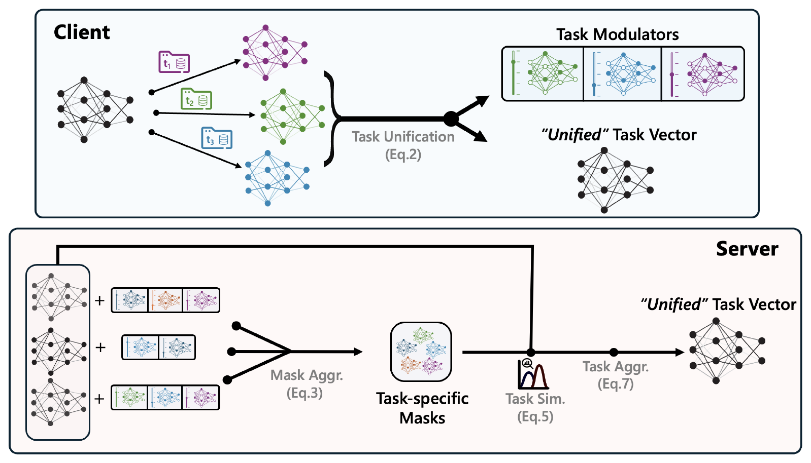

# MaTU

**Many-Task Federated Fine-Tuning via Unified Task Vectors**

Vasileios Tsouvalas · Tanir Ozcelebi · Nirvana Meratnia · FedGenAI @ IJCAI 2025

[ Paper](https://arxiv.org/abs/2502.06376) · [ Project](https://nousphera.github.io/MaTU/) · [Poster](https://nousphera.github.io/assets/posters/matu-a0-landscape.pdf)

## Abstract

Federated Learning (FL) traditionally assumes homogeneous client tasks; however, in real-world scenarios, clients often specialize in diverse tasks, introducing task heterogeneity. To address this challenge, Many-Task FL (MaT-FL) has emerged, enabling clients to collaborate effectively despite task diversity. Existing MaT-FL approaches rely on client grouping or personalized layers, requiring the server to manage individual models and failing to account for clients handling multiple tasks. We propose MaTU, a MaT-FL approach that enables joint learning of task vectors across clients, eliminating the need for clustering or client-specific weight storage at the server. MaTU constructs a single “unified” task vector per client and leverages lightweight task-specific modulators — binary masks and scalar rescalers — to disentangle and adapt per-task behavior. This design ensures stateless server aggregation and naturally scales to large task sets with minimal communication overhead. Evaluated across 30 datasets, MaTU achieves superior performance over state-of-the-art MaT-FL approaches, with results comparable to per-task fine-tuning, while delivering significant communication savings.

**Implementation:** task-specific LoRA training, unified-vector exchange, related-task aggregation and a native Flower App. See the [method settings](#method-and-aggregation-settings) for the equation-to-code map and aggregation settings.

[](https://nousphera.github.io/MaTU/#overview)

*One vector per client, with a binary mask and scalar for each task.*
[Method animation](https://nousphera.github.io/MaTU/#overview) · [Paper figure](https://arxiv.org/pdf/2502.06376v3#page=3)

## Requirements

Use an up-to-date **Python 3.11 or 3.12** on Linux or macOS. Keep the virtual environment in a path without spaces so Ray can start its workers.

```bash
git clone https://github.com/Nousphera/MaTU.git
cd MaTU
python3.11 -m venv "$HOME/.venvs/matu"
source "$HOME/.venvs/matu/bin/activate"
python -m pip install --upgrade pip
python -m pip install -r requirements.txt
```

The environment pins PyTorch 2.14.1, torchvision 0.29.1, timm 1.0.30 and Flower 1.40.0. On **Linux CPU**, run this before installing `requirements.txt` to avoid downloading CUDA libraries:

```bash
python -m pip install --index-url https://download.pytorch.org/whl/cpu \
  torch==2.14.1 torchvision==0.29.1
```

For CUDA, select compatible wheels using the [PyTorch installation guide](https://pytorch.org/get-started/locally/).

## Prepare datasets

Download official splits and export verified RGB ImageFolders:

```bash
python -m matu.prepare_data --dataset mnist --download --root data
python -m matu.prepare_data --dataset svhn --download --root data
python -m matu.prepare_data --combine data/mnist/tasks.json data/svhn/tasks.json \
  --output configs/tasks.json
python -m matu.prepare_data --dataset mnist --root data --validate-only
```

MNIST, SVHN, GTSRB and DTD have automatic torchvision acquisition. DTD uses partition 1 train/test; its validation split is excluded. For SUN397, Cars, RESISC45, EuroSAT or another task, import your acquired data with existing `train/<class>/images` and `test/<class>/images` directories:

```bash
python -m matu.prepare_data --dataset eurosat --source /path/to/split-eurosat --root data
```

Alternatively, preserve published split lists in a CSV with `path,split,label` columns (`split` is `train` or `test`; paths are relative to the source root):

```bash
python -m matu.prepare_data --dataset sun397 --source /path/to/SUN397 \
  --split-file /path/to/sun397-splits.csv --root data
```

Preparation preserves raw files, checks decoding and class consistency, rejects overlapping source files, and writes **SHA-256 hashes, source IDs, split policy and a portable `tasks.json`**. It refuses to overwrite an existing dataset. Combine any number of task manifests with `--combine`. [Dataset guide](docs/datasets.md) covers all eight benchmark datasets, split provenance and the CSV format.

## Training

The native app and CLI default to `configs/vision.json`: the paper's ImageNet-21k-pretrained ViT-B/32 with rank-16 adapters and prepared image tasks. Edit its device, client count and experiment size, then run:

```bash
flwr run . --run-config "config=\"$(pwd)/configs/vision.json\" output=\"$(pwd)/runs/vision-01\"" \
  --federation-config 'num-supernodes=30' --stream
```

For an explicit offline CPU execution check, `configs/smoke.json` keeps the same full ViT-B/32 and rank-16 adapters with random initialization (`pretrained=false`). It uses two clients, two tasks, two generated training images per task and one round:

```bash
flwr run . --run-config "config=\"$(pwd)/configs/smoke.json\" output=\"$(pwd)/runs/smoke-01\"" \
  --federation-config 'num-supernodes=2 init-args-num-cpus=2 client-resources-num-cpus=1' --stream
```

This checks probing, local LoRA training, unified-vector exchange and aggregation on generated 224×224 images. It does not measure pretrained accuracy or reproduce the paper benchmarks. Use a fresh output directory for each run.

`num-supernodes` must equal the JSON `clients` value. `manifest` resolves relative to its JSON config; dataset paths resolve relative to the task manifest. Use absolute config/output paths for worker processes. The paper-sized example uses ImageNet-21k-pretrained ViT-B/32, rank-16 adapters and CUDA; weights download through timm on first use. GPU scheduling instructions and a smaller image configuration are in [the dataset guide](docs/datasets.md).

Flower 1.40 runs a managed local SuperLink. If another project already has one running, use a separate state directory **and ports** before launching:

```bash
export FLWR_HOME="$HOME/.cache/matu-flower"
export FLWR_LOCAL_SUPERLINK_HTTP_API_PORT=39135
export FLWR_LOCAL_CONTROL_API_PORT=39137
```

See [Flower's simulation guide](https://flower.ai/docs/framework/how-to-run-simulations.html). Worker machines must have access to the configured data paths. This repository targets local research simulations.

## Pretrained models

The image configuration loads `vit_base_patch32_224.augreg_in21k` through
[timm](https://huggingface.co/timm/vit_base_patch32_224.augreg_in21k).
The backbone stays frozen while rank-16 qkv LoRA adapters are trained. Record the
weight revision and SHA-256 with each run; `final.pt` saves the adapters and task
heads to combine with that backbone. The explicit offline smoke configuration initializes the same full architecture from scratch and uses no download. Unsupported architectures are rejected; pretrained-loading errors never trigger a substitute model.

## Evaluation

The trainer evaluates every task on its held-out test split after each round,
reporting per-task accuracy and their unweighted mean. Test samples are excluded
from adapter training and task-head probing. Inspect a completed image run with:

```bash
python -m json.tool runs/vision-01/metrics.json
```

Use `partitions.json`, `config.json` and the prepared task manifests to compare the
same client/task allocation across methods. The [method settings](#method-and-aggregation-settings)
defines agreement, related-task transfer and serialized-byte accounting.

## Outputs and configuration

Each output directory contains `metrics.json`, `config.json`, `partitions.json` and `final.pt`: per-task accuracy, exact partitions, seed, checkpoint, backbone hash and encoded communication counts. Preparation traffic is reported separately. Record the dataset manifests alongside results.

- **Task ownership:** explicit `assignments` can specify tasks per client. The default assigns every task to every client; use explicit assignments for heterogeneous task ownership.
- **Task heads:** initial federated linear probing creates shared heads, then freezes them.
- **Communication:** counters include serialized records and payloads, with head-probing traffic reported separately; TCP/TLS framing is excluded.
- **Tests:** aggregation, optimization, frozen-backbone invariants, dataset integrity and Flower transport.

For a sequential debugging run with the same method:

```bash
matu --config configs/smoke.json --output runs/sequential-01
python -m pytest
```

## Method and aggregation settings

| Component | Code | Operation |
| --- | --- | --- |
| Shared pretrained origin | `training.adapter_vector`, `set_adapter` | Adapter differences from a common deterministic initialization; frozen backbone |
| Unification and modulators, Eq. 2 | `core.unify` | Sign of vector sum, maximum aligned magnitude, positive-alignment mask, L1-ratio scale |
| Agreement, Eq. 3 | `core.aggregate` | Absolute mean signs by default; signed mode available |
| Same-task aggregation, Eq. 4 | `core.aggregate` | Sample-weighted task vectors with an agreement mask; scale applied once |
| Task similarity, Eq. 5 | `core.aggregate` | `(mean(sign(a) * sign(b)) + 1) / 2`; zero coordinates contribute 0.5 |
| Cross-task transfer, Eq. 6 | `core.aggregate` | Exclude self, select similarity above 0.5 and top-κ neighbors; unnormalized weights |
| Combination, Eq. 7 | `core.aggregate` | Sum of same-task and cross-task terms by default; mean mode available |
| Client redistribution | `training.run`, `flower.main` | Unify the tasks assigned to each selected client |

### Aggregation settings

- **Agreement:** `agreement="absolute"` uses the magnitude of mean signs, so consistent positive and negative updates both receive agreement one. `agreement="signed"` implements the signed expression printed in Eq. 3; negative agreement can reverse an update's direction.
- **Combination:** `combine="sum"` follows Eq. 7. `combine="mean"` averages the same-task and cross-task terms when related tasks exist.
- **Related tasks:** `top_k=2` selects at most two neighbors above the similarity threshold. Set it explicitly for each experiment.
- **Zero coordinates:** exact sign ties produce zero; an entirely erased task receives scale zero. Unification is a lossy representation.

### Model and task configuration

The model is the paper's timm ViT-B/32 (`vit_base_patch32_224.augreg_in21k`), with rank-`r` qkv LoRA adapters and unit LoRA scale; the default rank is 16. Federated linear probing first trains shared task classifiers; those heads and the backbone are then frozen while the adapters are optimized.

Client class partitions use seeded Dirichlet sampling with repair of empty partitions. Set `assignments` to declare each client's tasks. The default assigns every task to every client; use explicit task ownership for heterogeneous studies. Keep task ownership, class partitions, optimizer, augmentation and adapter settings with the dataset manifests so comparisons use the same experimental conditions.

See [dataset preparation](docs/datasets.md) for official splits, CSV imports, task manifests and image configurations. Test examples are excluded from optimization and checkpoint selection.


## Results

**Published eight-task benchmark:** ViT-B/32, rank-16 LoRA, 30 clients,
20% participation and multiple tasks per client (task concentration 0.5).
Accuracy is averaged across tasks; bitrate is millions of bits per task per round.

| Method | Average accuracy (%) | Bitrate (M bits/task/round) |
| --- | --- | --- |
| FedAvg | 51.63 | 20.43 |
| FedPer | 48.37 | 17.16 |
| MaT-FL | 67.60 | 20.43 |
| **MaTU** | 79.47 | 8.04 |

MaTU and FedAvg/FedPer use 100 rounds; MaT-FL uses 300. Source:
[Table 2](https://arxiv.org/pdf/2502.06376v3#page=6).
[Explore all results](https://nousphera.github.io/MaTU/#findings).

## Citation

```bibtex
@inproceedings{tsouvalas2025matu,
  title={Many-Task Federated Fine-Tuning via Unified Task Vectors},
  author={Vasileios Tsouvalas and Tanir Ozcelebi and Nirvana Meratnia},
  booktitle={FedGenAI Workshop at IJCAI 2025},
  year={2025},
  url={https://arxiv.org/abs/2502.06376}
}
```

[MIT license](LICENSE). Publication figures, posters, pretrained models and datasets retain their original terms.
