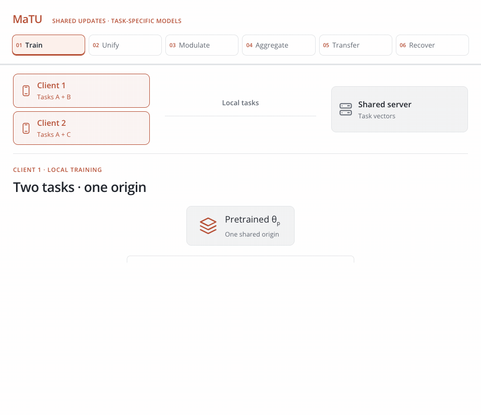

<h1 align="center">MaTU</h1>
<p align="center"><strong>Many-Task Federated Fine-Tuning via Unified Task Vectors</strong></p>
<p align="center"><a href="https://vtsouval.github.io/"><strong>Vasileios Tsouvalas</strong></a> · Tanir Özçelebi · Nirvana Meratnia</p>

<p align="center">
  <a href="https://arxiv.org/abs/2502.06376" title="Read the paper"></a>
  <picture></picture>
  <a href="https://nousphera.github.io/MaTU/" title="Explore the project"></a>
  <picture></picture>
  <a href="https://nousphera.github.io/assets/posters/matu-a0-landscape.pdf" title="View the poster"></a>
</p>

## Abstract

**MaTU** enables federated fine-tuning when clients learn **multiple, different tasks**. Each client expresses its task updates relative to a *shared pretrained model* and communicates **one unified vector**, together with lightweight *binary masks and scalar rescalers*. The server combines **same-task updates** and selectively transfers information between *related tasks*, then returns new unified vectors and modulators for clients to recover their task-specific updates. This design reduces communication and avoids retaining client-specific weights at the server. Evaluated across **30 vision datasets**, MaTU approaches *per-task fine-tuning performance* while supporting heterogeneous task assignments.

<p align="center">
  <a href="docs/assets/readme/method-light.mp4" title="Watch the method video">
    <picture>
      <source media="(max-width: 600px) and (prefers-color-scheme: dark)" srcset="docs/assets/readme/method-dark-mobile.gif">
      <source media="(max-width: 600px)" srcset="docs/assets/readme/method-light-mobile.gif">
      <source media="(prefers-color-scheme: dark)" srcset="docs/assets/readme/method-dark.gif">
      
    </picture>
  </a>
</p>

## Setup

Create and activate the `matu` environment:

```bash
git clone https://github.com/Nousphera/MaTU.git
cd MaTU
python3.12 -m venv --prompt matu "$HOME/.venvs/matu"
source "$HOME/.venvs/matu/bin/activate"
```

From the activated `matu` environment, install the requirements:

```bash
python -m pip install -r requirements.txt
```

## Data and Weights

Download and prepare your benchmark from [**MaTU-30**](https://huggingface.co/datasets/Nousphera/MaTU-30):

```bash
# Five tasks: MNIST, SVHN, GTSRB, DTD and EuroSAT
python scripts/prepare_data.py --benchmark small --hf-repo Nousphera/MaTU-30

# All 30 tasks
python scripts/prepare_data.py --benchmark thirty --hf-repo Nousphera/MaTU-30
```

> [!NOTE]
> Use `--benchmark eight` for eight tasks or `--dataset eurosat` for one. Task variants, splits and source licences are listed in the [dataset card](https://huggingface.co/datasets/Nousphera/MaTU-30#configurations).

### Prepare Model

Download the pretrained **ImageNet-21k ViT-B/32** encoder:

```bash
python scripts/prepare_model.py
```

## Run Experiments

From the repository root, set the shared **Flower App** options and run your chosen method:

```bash
# Shared five-task settings
common=(--benchmark small --nr-clients 30 --participation 0.2
        --local-epochs 1 --batch-size 32 --task-alpha 0.5
        --dirichlet-alpha 0.1 --device cuda)

# MaTU (Ours)
python scripts/run_experiment.py "${common[@]}" --method matu

# FedAvg
python scripts/run_experiment.py "${common[@]}" --method fedavg

# FedProx
python scripts/run_experiment.py "${common[@]}" --method fedprox

# FedPer
python scripts/run_experiment.py "${common[@]}" --method fedper

# MaT-FL
python scripts/run_experiment.py "${common[@]}" --method matfl

# NTK-FedAvg
python scripts/run_experiment.py "${common[@]}" --method ntk-fedavg

# Per-task centralized fine-tuning
python scripts/run_experiment.py "${common[@]}" --method centralized
```

> [!NOTE]
> All methods use **rank-16 query/value LoRA** with a frozen backbone and probed task classifiers. Runs use **100 rounds** (**300** for MaT-FL); metrics and adapter weights are saved in `results/`.

<details>
<summary><strong>All 30 Tasks</strong></summary>

Run the complete benchmark with full client participation:

```bash
python scripts/run_experiment.py --method matu --benchmark thirty \
  --nr-clients 30 --rounds 300 --participation 1 --task-alpha 0.2 \
  --dirichlet-alpha 0.1 --local-epochs 1 --batch-size 32 --device cuda
```

Replace `--method matu` with any baseline above.

</details>

## Citation

```bibtex
@inproceedings{tsouvalas2025matu,
  title={Many-Task Federated Fine-Tuning via Unified Task Vectors},
  author={Vasileios Tsouvalas and Tanir Ozcelebi and Nirvana Meratnia},
  booktitle={FedGenAI Workshop at IJCAI 2025},
  year={2025},
  url={https://arxiv.org/abs/2502.06376}
}
```

[MIT License](LICENSE)
